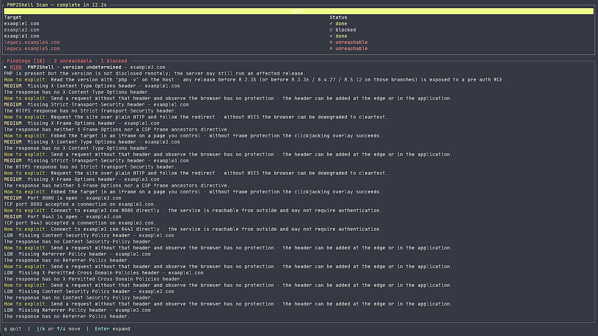

# PHP2Shell-TUI 

Exposure scanner for **CVE-2026-109618** / **CVE-2026-109619** ("PHP2Shell") and general web
misconfiguration. Each finding carries evidence, a one-sentence exploit line, and runnable
reproduce steps.

It only contacts the hosts listed in your config — no discovery, no host argument, no brute force.
Use it only on hosts you own or are authorized to test.

**Note:** By default it checks the **PHP2Shell** exposure condition. With `--verify` and an
explicit `poc_profile` or `poc.guess: true`, it attempts the real PHP2Shell chain against the
target on the first run: no test endpoint, no preflight POST. Only the amd64 PHP 8.4.26 mod_php
build is verified; the other shipped profiles are ordered guesses. HTTPS is attempted with
verified TLS but is experimental; FPM is not supported.



## Requirements

- PHP 8.2+ with `curl`, `json` and `openssl` (all standard)
- Composer

## Install
Download [php2shell-tui](https://github.com/uchm4n/php2shell-tui/raw/refs/heads/feature/php2shell-tui/php2shell-tui)

## Configure
Edit `php2shell-tui.yaml` it is a default configuration file. 
You can also specify a different config file with `./php2shell-tui scan --config other.yaml`


```yaml
targets:
  - https://example.com
  - https://example1.com
  - https://example2.com
  - https://example3.com
  
  - url: https://legacy.example4.com
    paths: ["/wp-content/uploads"]

  - url: https://legacy.example5.com
    paths: [ "/admin", "/wp-admin", "/login" ]
    
  - url: https://203.0.113.10/
    vhost: legacy.example.com        # Host: header to send to that IP
    paths: ["/wp-content/uploads"]   # extra directories to check for webshells

  # Optional real-server check. No POST is sent without --verify.
  - url: https://app.example.com/
    post_path: /index.php

checks:
  php_presence: true
  php_version: true
  php2shell: true                    # default on; POST only with --verify
  sensitive_files: true
  security_headers: true
  tls: true
  app_fingerprint: true
  webshell_indicators: true
  open_ports: true
  injection: false                   # also needs --verify

poc:
  guess: true                        # try the ordered list; also needs --verify
  arch: any                          # any | amd64 | aarch64
  workers: 150                       # prefork workers to pin; set to the target's actual count
  max_attempts: 5
  total_timeout: 300
  profiles:
    - php-8.4.26-apache-bookworm-amd64   # verified in the lab
    - php-8.5.11-apache-bookworm-amd64   # public offsets, not verified here
    - php-8.5.11-apache-bookworm-aarch64
    # ... see php2shell-tui.yaml for the full ordered list

options:
  concurrency: 8
  timeout: 10                        # seconds per request
  connect_timeout: 5
  delay_ms: 100                      # per-host politeness delay
  min_severity: medium               # below this: hidden from text/markdown and the exit code

output:
  format: tui                        # tui | text | json | markdown
  report_dir: ./reports
```

## Usage

```bash
./php2shell-tui scan                     # scan; TUI when attached to a terminal
./php2shell-tui scan --format json       # pipeable JSON on stdout
./php2shell-tui scan --format markdown --output-dir ./out
./php2shell-tui scan --config other.yaml
```

The results stay on screen when the scan finishes: the target table shows the final state of every
host, the findings pane stays interactive, and a failure is shown in a red banner instead of
dropping back to the shell. Press `q`, `Esc` or `Ctrl-C` to close the TUI; press `r` to restart the
whole scan (`j`/`k` or arrows move, `Enter` expands a finding). The report is still written to
`report_dir`.

Exit codes: `0` clean, `1` findings at or above `min_severity`, `2` error, `130` cancelled from the TUI.

When `--verify` is set, the active check has two modes:

- `poc_profile: <id>` runs that one profile.
- `poc.guess: true` tries `poc.profiles` in order, up to `poc.max_attempts`, and stops early on a
  marker, a fatal error, or a target that stops responding.

Each attempt pins `workers - 1` prefork connections, sends the real PHP2Shell chain, writes a short
relative proof file, and fetches both `<post_path directory>/<file>` and `/<file>`. The scanner
emits **Critical** only when the exact unique marker is returned. A failed guess is reported as
“proof not obtained,” never as “safe.”

While the proof runs, the TUI shows `◐ verify 2/5 · 23s` and the title says `verifying 2/5`. Press
`r` at any time to abort the current run and start a fresh scan.

**Known limitation**: a baseline response of `403`, `407`, `429`, or `503` marks the target unscannable
and skips every check, including the active proof. Use a baseline path the scanner can reach, or
run it from a vantage point that can reach the application.

`injection: true` adds SQL injection, reflected XSS, and local file inclusion probes. They also
stay off until `--verify`:

```bash
bin/php2shell-tui scan --verify          # --verify is the explicit authorization
```

Rails: the full chain pins `workers - 1` connections plus four chain requests. Hosts outside the
target are never contacted, pages that differ between two identical fetches are skipped, and
findings ship reproduce steps rather than a destructive payload.

## What it looks for

- PHP versions below the PHP2Shell fix (8.2.35 / 8.3.36 / 8.4.27 / 8.5.12), including EOL branches
  and release candidates
- Exposed secrets and debug files: `.env`, backups, `phpinfo`, database consoles
- Missing or weak security headers (CSP, HSTS, frame and content-type protections)
- TLS certificates that are expired, expiring soon, or issued for another hostname
- Webshell indicators in common upload paths
- Publicly reachable high-risk ports
- With `--verify` and a matching `poc_profile` or `poc.guess`: a real, first-run RCE proof
- With `--verify` and `injection: true`: SQL injection, reflected XSS, local file inclusion

## Profiles and guess mode

Only `php-8.4.26-apache-bookworm-amd64` is verified in this engine, for the official amd64
`php:8.4.26-apache` build. Use `poc_profile` only after confirming the target matches that exact
build.

The shipped `poc.profiles` list also includes 13 builds with public libphp offsets from the
`devploit/php2shell` offset inventory (MIT). They are marked `rce_verified: false` and use the
8.4.26 stage baseline; they are guesses, not verified profiles. Most are aarch64, so amd64
coverage beyond 8.4.26 is currently limited to 8.5.11. There are no public offsets for 5.4–7.3.

The proof writes a short relative file in the PHP working directory and fetches both the script
directory and webroot candidates. If neither returns the marker, the finding says “proof not
retrievable”; it never claims success without the marker.

HTTPS is attempted with verified TLS, but the verified transport is HTTP; treat HTTPS as
experimental. FPM is refused because the verified chain is mod_php only.

```sh
bin/php2shell-tui scan --config target.yaml --no-tui --format json --verify
```

## Development

Build the PHAR with `composer build`, then run `./php2shell-tui`.

```bash
composer test
```

The suite starts a local fixture server; nothing external is contacted. Contributions: branch,
keep the suite green, open a pull request.

## License
MIT
